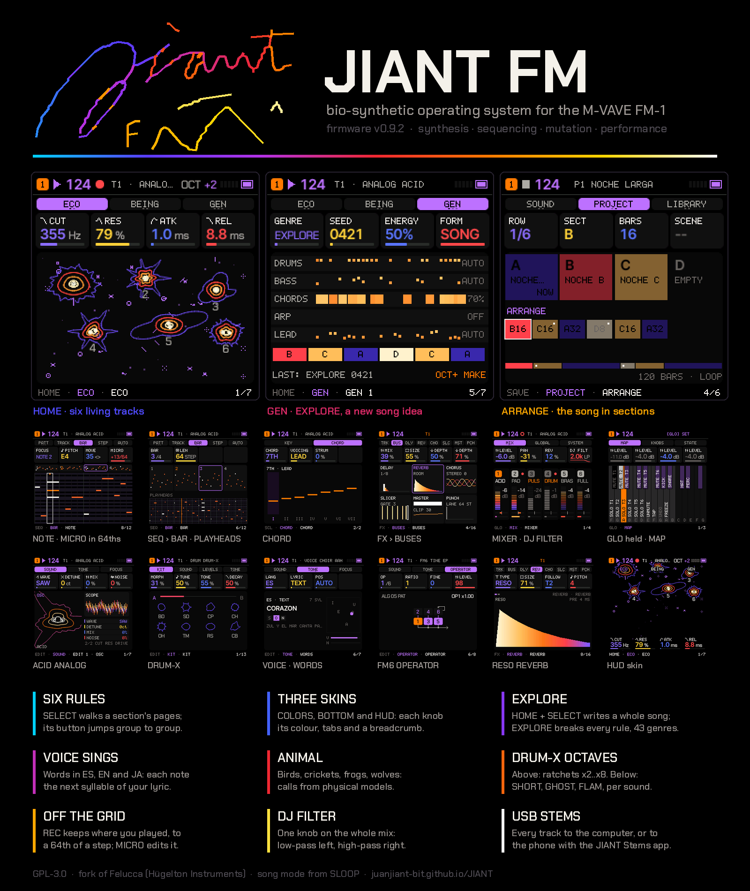
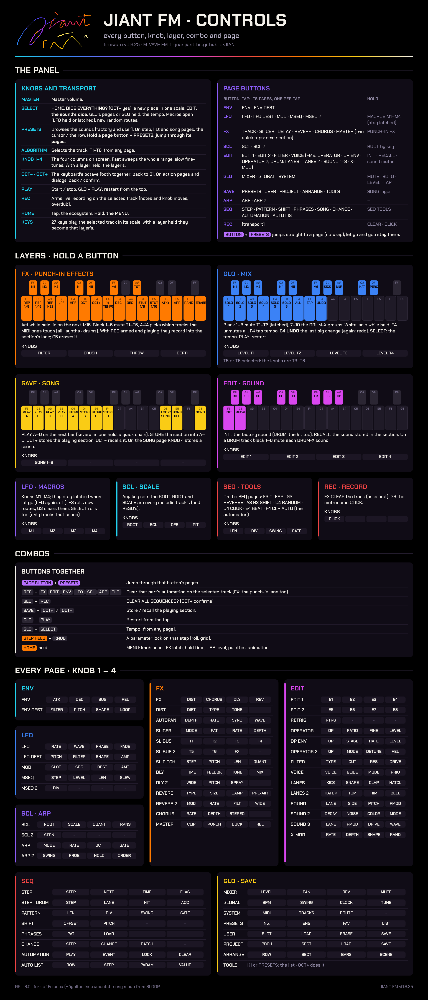
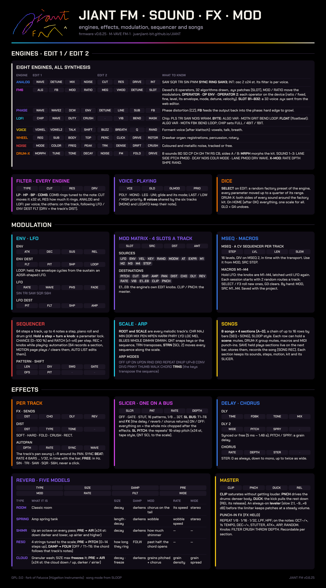
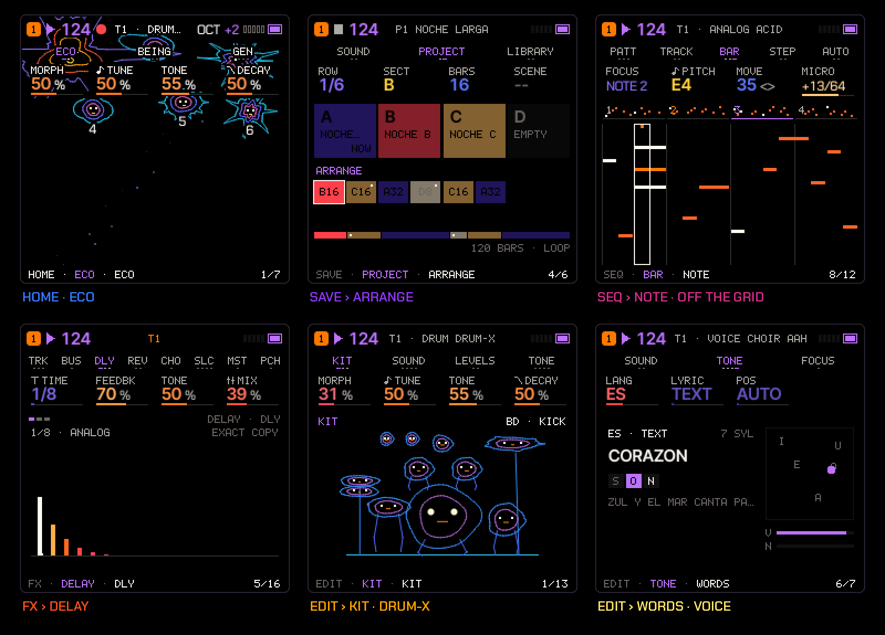

# JIANT FM

**Bio-synthetic operating system for the M-VAVE FM-1** — synthesis, sequencing, mutation, performance.

[](LICENSE)
[](https://juanjiant-bit.github.io/JIANT/)



JIANT FM is an alternative firmware for the **M-VAVE FM-1**, made for playing live and building whole songs without
a computer. It is a fork of [Felucca](https://github.com/hugelton/Felucca) 1.1.5.1 by Hügelton Instruments (GPL-3.0)
and takes its song system from [SLOOP](https://github.com/isod89/sloop-fm1).

**▶ [Try it in the browser](https://juanjiant-bit.github.io/JIANT/)** · **[Web installer](https://juanjiant-bit.github.io/JIANT/webapp/installer/)** · **[Web editor](https://juanjiant-bit.github.io/JIANT/webapp/editor/)**: the emulator runs the same code as
the FM-1, with sound, and is played with your computer keyboard or the mouse. The emulator, the installer and the
editor update themselves with every change merged into `main`.

> **Status: in development (v0.6.25).** It builds and passes every test (Felucca's and its own), Back up the flash before installing it.

## Cheat sheets

Two printable sheets with everything on the device. Click an image to open it full size, or download the PDF.

| Controls | Sound · FX · Mod |
| --- | --- |
| [](docs/cheatsheet-controls.png) | [](docs/cheatsheet-sound.png) |
| Every knob and button, the layers with their key maps (FX, GLO, SAVE, EDIT, LFO, SCL, SEQ, REC), the combos and every page's four knobs. **[PDF](docs/cheatsheet-controls.pdf)** | The eight engines' EDIT pages, FILTER, VOICE, ENV, LFO, the MOD matrix, MSEQ, macros, the sequencer, scales and ARP, songs, and every effect: DIST, the SLICER bus, delay, the five reverbs and the master. **[PDF](docs/cheatsheet-sound.pdf)** |

## Changelog

Every update is listed here, newest first.

### v0.6.25
- **Interface audit, second round.**
  - **SAVE > TOOLS is a list**: KNOB 1 (or PRESETS, or any knob) moves the pick down and up, OCT+ does it (its dialog
    first). It was one knob per action.
  - **The footer on the song's and the instrument's pages** (PROJECT, ARRANGE, TOOLS, GLOBAL, SYSTEM) shows the
    project and its name, not the track's engine and sound.
  - **Clearer messages**: SAVED (NO FLASH) instead of SAVED (RAM); an empty favourites list says NONE (was --/0).
  - **Layers**: on GLO, a track asleep (TRACKS 4) has its SOLO and MUTE dim and its key quiet.

### v0.6.24
- **Interface audit, first round.**
  - **The song in one place**: SAVE > ARRANGE (SEQ > SONG was the same page twice and is gone from SEQ).
  - **Readable names**: LEVEL, SWING, CLOCK, DEPTH, STEREO, FEEDBK, SPRAY, FOLLOW, PUNCH, TRACKS, ROUTE, SCALE, QUANT,
    TRANS, OFFSET, PITCH, FILTER, SHAPE, PHASE, ORDER, VOICE, GLIDE, DEST, DETUNE, NOISE, CRUSH, DRIFT, DECAY, COLOR,
    VOWEL, BREATH, MORPH, MOTION, DRIVE, ROTOR, RATIO... instead of LVL, SWG, CLK, CDP, STER, FDBK, SPRY, FOLW...
    Library files saved by the web editor with the old names load as before.
  - **Mixer (6 columns)**: each sound's name cut to fit (no "..."); a muted track keeps its name, in the accent colour.
  - **FX in sections** (TRACK, SLICER, DELAY, REVERB, CHORUS, MASTER): a tap the next page, two quick taps the next
    section; the footer counts within the section.

### v0.6.23
- **ARRANGE: delete a row right there**: KNOB 2 (SECT) turned left of A asks **DELETE ROW?** (OCT+ yes).

### v0.6.22
- **ARRANGE (SEQ > SONG) redrawn, after SLOOP's arranger**: the song as a column of rows, each a coloured section chip
  (A, B, C, D each its own heat), its bars as blocks that fill as they play, the count on the right and a dot for its
  scene; a section with nothing stored says EMPTY. Under them **+ ADD** (how many rows of the 16 are used) and **END**.
  On the right the whole song as one strip (each row as long as its share of the bars, the play head on it) and the bars
  in all. KNOB 1 the row, 2 its section (left of A: DELETE ROW?), 3 its bars, 4 its scene.
- **END: STOP, x2 .. x8 or LOOP**: the song plays once, that many times, or round and round (KNOB 2 on END).
- **Tracks asleep (TRACKS 4) in grey**: on HOME as a muted being, on the mixer greyed with OFF.

### v0.6.21
- **HOME + SELECT dices everything** (after **DICE EVERYTHING?**, OCT+ yes / OCT− no): one musical scale for every
  engine and the effects, each track a new engine, sound and sequence in that scale (T1 a bass; the others a lead, pad
  or arpeggio; DRUM a beat), the macros' routes and the delay, reverb and chorus. Tempo, levels and mutes stay.
- **SELECT by page**: the tempo on GLO's pages (GLOBAL, SYSTEM, MIXER), the sound's dice on EDIT only, nothing on the
  others (it says where).
- **UNDO: GLO held + G4**: the last big change taken back (DICE ALL, a sound diced, a clear, INIT, RECALL, a pattern or
  project loaded); again: forward. The transport keeps playing.
- **Installer**: a warning to return to official V15 first when coming from another custom firmware (a brick was
  reported going straight from one), with the button right there; Install is enabled once you confirm the FM-1 runs
  official V15 or JIANT.

### v0.6.20
- **SCALE is global, strictly**: ROOT, SCALE and QNT are one for the whole song. Before, a project, MIDI or
  automation could leave a track in its own scale; now every melodic track follows the selected one's at once.

### v0.6.19
- **TRACKS on GLO > SYSTEM** (KNOB 2: TRKS 4 LOW / 6 HIGH), next to the tracks: the same setting as MENU > AUDIO >
  TRACKS, saved. Going to 4, T5 and T6 now fade out (they were cut: a click).
- **Less stutter under load** (a full check of the last updates):
  - the overload guard sheds a voice again only after two overloaded blocks in a row (since 0.6.17 one spike, e.g. a
    key scan, was enough: a voice cut every 3 ms, clicks and cut tails);
  - the load budget is measured on the sound alone, and it only takes tails under -50 dB (was -30: audible);
  - a track let go from a black-key mute or a solo no longer keeps the FX layer working every block.
- **GRAIN delay without clicks**: with a long TIME, a grain's new spray moved the other grain in the middle of its
  window (a click every grain); and the FX buses' quiet gate now opens and reopens with a short fade (it jumped).
- **DRUM-X DRV**: several loud hits at once with DRV high could wrap into a full-scale click; held now.
- **LATCH**: turning HOLD off or ARP on with a key down, SEQ TOOLS CLEAR and REC CLEAR ALL now let the latched notes
  go (they kept droning and stacked up); a panic also ends them on MIDI OUT.
- MENU > ABOUT's AUDIO LOAD updates live.

### v0.6.18
- **MENU > AUDIO > TRACKS: 4 LOW (the default) or 6 HIGH.** With 4, tracks 5 and 6 sleep: they keep their sound,
  steps and mix but don't play or cost anything, and the whole CPU goes to T1-T4 (selecting T5 or T6 says so). With
  6, all six play and you know you're near the limit: watch the load meter. The setting is kept with the others.
- **Release tails ring out again with a sequence running.** Since 0.6.16 the load budget took the oldest released
  voice for every new note once the audio passed 65 %, so with the sequencer playing the tails were cut. Now it only
  takes a tail that is nearly gone (under -30 dB); otherwise the note is added and the tails ring. The guard at 80 %
  stays the last line.

### v0.6.17
- **DRUM-X at half the work**: each hit computed at 22 kHz (it is low-passed at ~8 kHz anyway) and brought back to
  full rate, its noise kept at the same level: the kit costs about 45 % less, the heaviest part of a busy song.
- **The guard acts sooner**: the load budget from 65 % (was 70), and over 80 % a voice fades after a single
  overloaded block (was two in a row).
- **MENU > ABOUT shows the audio's load** (scroll with PRESETS): NOW and PEAK (% of the time the audio took), LATE
  (blocks that came too late: each one a click) and SHED (voices the guard faded), since power-on. Send a photo of
  it after a click to tell what happened.

### v0.6.16
- **Stable under load: the load budget.** The device measures how much of its time the audio takes. Past 70 %, the
  sound may not grow: a new note takes a voice (the oldest released first) instead of adding one, and CLOUD spawns
  half its grains; under 60 % for a while, back to normal. The overload guard (80 %) stays as the last line. The
  load stops climbing before the screen lags or the sound clicks, whatever you turn on.
- **Mutes and solos cost nothing**: GLO's solo and the FX layer's black-key mutes were the sound silenced after
  being made; now they are MIDI mutes: the track gets no new notes and, once faded, its voices end.
- **FM6 plays 4 voices a track** (was 6): six operators a voice, the heaviest engine.
- **DRUM-X's DRV and knee on the kit's sum** (were each hit's): the same glue on the bus, half the work.

### v0.6.15
- **No hiss at rest with CLIP up**: the clipper rounded a tail's tiny negative residue down (-1) and drove it x4: a
  constant offset with a faint hiss on one side, even with every track off. Now rounded; and the FX buses (delay,
  chorus, reverbs) fade their own last residue to silence once nothing has been sent to them for a while (1.5 s at
  -55 dB, 4 s at -36 dB, 8 s at -30 dB), so the tails' rounding never leaves a hum. CLOUD's FREEZE is never gated.
- **CLOUD always dies out**: past SIZE ~80 its loop rang on for ever (its tail fed back into its own line); now only
  the grains feed it: a long tail that ends (SIZE 126 stays a faint wash for long, close to FREEZE).
- **More headroom**: DRUM-X stops computing a hit at -66 dB (was -84), FM6 ends a released note once its carriers
  are under ~-66 dB (its six operators no longer run for seconds on an inaudible tail), and the overload guard steps
  in at 80 % of the audio's time (was 85 %): it fades a voice before the sound clicks and the screen starves.

### v0.6.14
- **No more sharp highs when changing presets**: the notes still sounding used to take the new sound's values at once
  (its filter, its envelope amounts), jumping bright and loud. Now they fade out in ~3 ms with the sound they had
  (all of it, kept the moment before the change), and the new notes start clean. Also on user presets and sections.
- **SEQ TOOLS** (SEQ held): each cell shows its key with the octave (F3 CLEAR, F4 CLR AUTO: both read "F" before),
  and the footer shows **REC: CLEAR ALL** (all six tracks' steps and automation, OCT+ confirms), which was nowhere
  on screen.
- **Key LATCH**: with ARP OFF, **ARP 2 > HOLD ON** latches the keys: the notes keep sounding when you let go, the
  next chord replaces them, HOLD OFF lets them go.
- **CLOUD costs about a third less CPU**: its grains computed every other sample (the line they read is written at
  half rate anyway), the same sound. First step against the lag and clicks with six tracks busy.

### v0.6.13
- **AIR on SHIMMER and CLOUD** (REVERB's fourth knob, PRE on ROOM / SPRING): ±24 semitones. Down, the reverb goes lower
  and darker; up, higher and airier, in pitch and in filter at once. SHIMMER's loop climbs octave + AIR on each pass
  (an octave down to two up); CLOUD's grains move with it. 0 sounds as before.
- **CLOUD's graph** is a swarm of moving dots: AIR lifts or sinks the cloud, MOD splits it into octave layers, the
  grains playing now drawn bigger.
- **AUTOPAN's graph** fixed (SIN came out wrong) and drawn like LFO's: two cycles across, the playhead and a dot on
  where the pan is now, L up, R down.
- **CHORUS STER** moves its graph: the three taps fan apart with it, and fold into one line at mono.
- **SAVE > TOOLS** says what each knob does (CLEAR SEQ, INIT SOUND, DELETE ROW n, CLEAR SONG) instead of "TURN TO PICK";
  the page name in the footer is lit, so you always see where you are.
- **LOFI BYTE / FLOAT: RETRIG** (EDIT > RETRIG, after EDIT 2): **RTRG ON** starts the formula from the top on every
  note, instead of carrying on where it was.

### v0.6.12
- **Projects in SAVE**: SAVE > PROJECT now shows the project (1–8, each a whole song) and its four **sections A–D**,
  each with its own sequences and sounds for the six tracks. KNOB 1 opens another project (stopped; the music you are
  playing stays, ready to be stored into one of its sections), KNOB 2 or PRESETS picks the section, LOAD makes it the
  music, SAVE stores the music into it. Each section shows whether it's saved, **NOW** on the one playing and the bars
  it plays in the song; the arrangement sits below in a line (A4>B8>D4>B8).
- **ARRANGE**, right after PROJECT: the project's song, sections chained by bars as in SLOOP (the same rows as
  SEQ > SONG; OCT+ plays it). To copy a section, LOAD it and SAVE it into another letter.

### v0.6.11
- **FM6 voice bank**, from Felucca 1.5.1: a whole 32-voice DX7 cartridge (.syx) sent from the web editor (6-OP FM tab,
  **Send to the device's voice bank**), picked on the device with **SLOT B1–B32** after F1–F8 and OWN (empty slots
  skipped; the voice's name above the algorithm). Loading a voice copies it into the track, so projects and presets
  keep it whatever the bank holds later. Its own flash sector (0xE7000), written so a power cut leaves the old bank or
  the new one, never half; editor commands 74–77 as Felucca's. The full backup doesn't include it: keep the .syx.

### v0.6.10
- **FM6 fully editable on the device**, brought from Felucca 1.5.1: EDIT > **OPERATOR** (operator 1–6, RATIO / FIXED,
  FINE, LEVEL), **OP ENV** (each stage's RATE and LEVEL, drawn) and **OPERATOR 2** (MODE, DTUN, VEL), on an FM6 track
  only. The patch becomes the track's own (SLOT OWN), saved as always; no new format, a few bytes of RAM. An edit keeps
  the patch's volume trim (0.6.8), so the level doesn't jump while you turn.
- **Fix**: a card could keep a stale gauge colour or width (or lose its tail with a long label) until the page was
  redrawn; its cache now holds the whole card.

### v0.6.9
- **AUTOPAN** per track (FX > AUTOPAN, after DIST): DPTH, RATE, SYNC (BEAT: 4 BARS .. 1/32 in time with the bar;
  FREE: Hz) and WAVE (SIN TRI SAW SQR S&H), through the pan's glide so even SQR doesn't click; its own graph. It
  lives in the slots of the old per-track slicer (a bus since 0.6.3): no more memory, the project format unchanged,
  every old project and preset loads with it off.
- **CHORUS > STER**: the chorus's stereo amount, 0 as it always sounded, down to mono, up to about twice as wide
  (in a stored slot that was unused).
- Cheat sheets and manual updated.

### v0.6.8
Fixes from the first users' reports:
- **No more crackles turning knobs.** Measured on every engine, a knob turned fast against the same move made smooth:
  - **FILTER** (every engine but ANALOG): going in and out of the chain (CUT at the top with RES 0, the LP open) and
    changing TYPE now crossfade, the filter starting from the sound instead of a stale state. It clicked each time CUT
    or RES crossed the open point (FM6's CUT 17x the high-frequency energy, now as smooth as a slow turn).
  - **LEVEL and PAN** glide (~3 ms) instead of stepping at each knob move.
  - **DIST** comes in smoothly from 0: DST 1..8 blend the dry sound into the drive (at 1 it was the full drive, with
    its low cut, at once).
- **FM6: SysEx voices no longer distort.** DX7 voices with several carriers at full came out up to 5x louder than the
  factory patches, and their chords kept the master's limiter about 10 dB down (that was the glitchy, noisy sound). A
  voice above the level every voice is made for is now trimmed to it, per patch and automatically: its chords
  sit where the factory patches' do (the limiter about 2 dB, as theirs). Quieter voices and the 8 factory patches are
  untouched; nothing is ever boosted. Tested with 71 classic DX7 voices.
- **SEQ TOOLS: F4 CLR AUTO** clears the selected track's automation and parameter locks (every step), the steps stay.
  It breathes when there is automation to clear. Next to F3 CLEAR (the sequence).
- **Video v2** (`tools/video/`): every effect, DRUM-X's pages, the modulators, sequencers and automation, a beat from
  soft to industrial at 132 BPM, fast montage cuts; the captions come from the capture's own script.

### v0.6.7
- **Cheat sheets** in the README: controls, and sound · effects · modulation, as images and printable PDFs.
- **Page jump fix**: once you turn PRESETS with a page button held, that button's layer (its map) stays off until you
  let the button go, even if you keep holding past the HOLD time or the first turn came at the very moment you pressed
  it. Hold it again afterwards and the layer works as always.
- **Presentation video tools** (`tools/video/`): `capture.c` plays a 60 s demo song on the real engines in the host
  build and records the FM-1's screen and audio; `compose.py` makes a 1080p video from them in the project's look.

### v0.6.6
- **Jump straight to a page**: hold a page button (ENV, LFO, FX, SCL, EDIT, GLO, SAVE, ARP, SEQ) and turn **PRESETS**
  to go through that button's pages forwards or back (FX has 13, EDIT up to 16), the title on screen; let go and you
  stay on that page. It doesn't take anything away: with a button held, PRESETS did nothing before; a tap still goes to
  the next page, and once you used a layer's knobs or keys while holding, PRESETS stays out of it.

### v0.6.5
- **RESO (reverb) changes chords now.** On RESO, the REVERB page's PRE knob becomes **PITCH** (the strings' chord
  0–14 steps up the scale) and DAMP becomes **FOLW**: OFF, or T1–T6, the chord built on the lowest note that track
  plays, so the strings follow your bass line or your chords, gliding from one to the next (the chord stays when the
  track goes quiet). The pre-delay and the damping were barely used on RESO; ROOM, SPRING, SHIMMER and CLOUD keep them.

### v0.6.4
- **LOFI FLOAT: DRV is gone, FBK takes its place.** DRV had a scaling bug that silenced the engine as soon as it was
  turned up, and it duplicated the DIST on the FILTER page anyway. **FBK** (feedback) sends the output back into the
  formula's time: the floatbeat modulates itself like FM, from a slight shimmer to chaos, a different deformation on
  every ALGO. Projects saved before keep their values (FBK starts where DRV was).

### v0.6.3
- **The SLICER is now one slicer on a bus, like a sampler's chop.** Its settings (mode, pattern, rate, depth) are the
  section's, and on **SL BUS** / **SL BUS 2** you choose with seven ON/OFF switches what goes in: **T1–T6** and
  **FX** (the delay, reverb and chorus returns). Everything ON turns it into a **stutter sequencer for the whole mix,
  after the effects**: the reverb and delay tails get cut too. With FX OFF the tails ring free over the cut.
  The routed tracks enter after their DIST, filter, level and pan; their sends still go to the effects.
- **SL PITCH**: the repeats (STUT) follow a **16-step pitch sequence** (±24 semitones, with the mod sequencer's page
  layout: KNOB 1 the step, KNOB 2 its pitch, LEN, QNT). Played like a tape (higher = faster), the loop keeps the
  step's rhythm; **QNT SCL** snaps the steps to the song's scale. One sample turns into an arpeggio.
- No limit of tracks any more (STUT on four was the 0.6.2 compromise), the same memory as before (32 KB, now a
  stereo recording of 371 ms), and less CPU: one slicer instead of one per track.
- Each section of a song keeps its own SLICER settings. Projects from before load with their slicer settings turned
  into the bus's: the first track that had it on gives the mode, pattern, rate and depth, the tracks that had it on
  go in, FX stays out.

### v0.6.2
- **SLICER memory shared**: GATE works on all six tracks as before; **STUT** (the one that records and repeats) can
  run on **up to 4 tracks at once**. A fifth STUT track plays live without repeats and the screen says
  **STUT: 4 TRACKS MAX**; when one of the four leaves STUT, the waiting one takes its place on the next step. Each
  track keeps its own pattern, rate and depth, and its sends still follow the chopped sound. This frees 16 KB of
  the big-buffer memory (pool now at 92 %, 25 KB free) for future effects.

### v0.6.1
- **MIXER: the six tracks at once** in the JIANT style, as six thermal columns (number, sound, LEVEL as the heat
  column with the meter over it, its dB, PAN and REV as two bars underneath). The other styles keep four cards that
  follow the selected track.

### v0.6.0
- **Six tracks instead of four.** T5 starts on PHASE and T6 on WHEEL (any engine can go on any track, as always),
  each with its own sequence, sound, effects sends and automation. **ALGORITHM** scrolls T1..T6.
- **Same storage, everything kept**: still 8 songs × 4 sections plus the 4 project slots, and the song sequencer
  (rows of sections with repeats and scenes) works as before, so you can build whole songs with intro, verse,
  chorus and bridge. To fit six tracks in the same space, sections are now saved **compressed**: only the steps
  that have something, and only the parameters you changed, are stored. The music at power-on takes about a
  quarter of a section; even six tracks with 4-note chords on all 64 steps fit.
- **A fill warning**: a moment after you stop editing, if the music is near the size of a section the screen says
  **SECTION 90% FULL**; if it no longer fits, **TOO FULL TO SAVE**. Saving a section in that state says
  **SECTION FULL** and changes nothing: the section already saved stays as it was. All memory is fixed at build
  time (nothing is allocated while you play), so a full section can never crash the system.
- **Projects and sections from 0.5 load as they were**: their four tracks keep their sound and steps, T5 and T6
  start empty on their default sounds.
- **GLO** (held): black keys 1–6 mute T1–T6, 7–10 the DRUM groups (KICK, SNARE, HAT, PERC); white keys F3–D4 solo
  T1–T6 while held, E4 unmutes everything, F4 tap tempo. The four knobs are T1–T4's levels, or T3–T6's when T5 or
  T6 is selected. **FX** (held): black keys 1–6 mute T1–T6.
- **MIXER** shows four tracks at a time and follows the selected one (T5 or T6 selected: T3–T6). (0.6.1: all six in the JIANT style.)
- **HOME**: six beings in the ecosystem, a bit smaller.
- **Song scenes** remember the mutes of T5 and T6 too. **Automation** (knobs and per-step locks) works on all six.
- **MIDI IN**: ROUT **CH1-6** (was CH1-4): channels 1–6 play tracks 1–6, 7–16 stay free for other instruments.
- Web editor: six tracks in the track selector, the mixer and automation.

### v0.5.5
- **FLOAT is a floatbeat generator now**: bytebeat's sibling in floats. Each of the 32 ALGOs is a formula of `t`
  made of sines, as in the floatbeat scene: `sin(t·(t>>11 ^ t>>13 & 7))`, FM whose index walks with `t`'s bits,
  melodies read from nibble tables, kicks, snares and hats inside the formula, Sierpinski partials, drive and folds,
  staircase sines, xor'd and dropped bits, risers, polyrhythms, chords whose root walks… rhythm, melody and timbre at
  once. `t` runs 32 steps per cycle of the note, so every formula plays in the key you hold (and, as in bytebeat, its
  rhythm runs faster up the keyboard). It shares BYTE's controls: **VAR** mutates `t` (8 ways), **MOTN** runs its
  slow bits faster or slower, **BEND** folds it, **LOOP** locks it into a short window; the new **DRV** folds the
  output from clean to wild.

### v0.5.4
- **FLOAT makes patterns now, not just waveforms.** Every ALGO is a step sequencer: 8 patterns (an arpeggio, a
  melody, a Sierpinski rhythm, a 5-in-8 euclid, a random walk, a `t>>9 % 13` line, a drone with 3-against-4 accents,
  octave leaps) × 4 smooth timbres (sine, FM that darkens as each note falls, wavefold, hard sync sweeping down).
  The notes are harmonics of the key you play (just intonation), the steps are the song's 1/16 notes.
- **New knob, MOTN (motion)**, on BYTE and FLOAT, in the slot that was empty: the speed of the formula's time. In
  FLOAT it goes from one step per bar to steps so fast the pattern turns into a timbre; in BYTE it speeds up or slows
  down the formula's slow bits (its rhythm and melody) without changing the pitch. 64 is as written.
- **VAR is drastic now**, on every BYTE and FLOAT formula: it mutates the formula's time in 8 different ways (stairs
  that transpose as they go, xor and or with itself, holes in the rhythm, the phrase backwards, multiplied,
  scrambled), so each formula gives many timbres and sequences.
- **The second LOFI page cleaned up**: BYTE shows MOTN · GRIT · BEND · LOOP (GRIT holds samples longer, a rate
  crusher), FLOAT MOTN · DCY · BEND · LOOP (DCY: from short plucks to legato). The second RES (already on the FILTER
  page) and the empty slot are gone. Projects saved before keep their sound (MOTN set to 64, GRIT/DCY to 0).

### v0.5.3
- **A new power-on screen**, after feedback from the community: the signature used to be drawn as straight segments
  (it looked like MS Paint next to the rest of the interface). Now each stroke is smoothed and drawn as a curve with a
  round pen that tapers at the ends, like ink; the pen's tip is a glowing nucleus; and three small beings (a
  radiolarian, an amoeba, a hydra) swim in from outside the screen and circle the signature while it is written,
  warming up as it grows and pulsing once it is done. It costs 16 bytes of RAM, and the splash now runs on the clock
  (drawing the beings does not make it longer). MENU > ANIM OFF still shows it whole at once.

### v0.5.2
- **BYTE: new formulas, no silent starts.** The 17 most familiar one-liners (`t*(42&t>>10)`, `t&t>>8` and friends)
  were replaced by less obvious ones: rhythms and arpeggios after Tejeez, xpansive's "lost in space", a melody of
  `t>>9` modulo 13, textures built from `t%24` and `t%19`, and more. Each formula now starts where it is already
  moving: 14 of the 32 used to sit silent for up to half a second after the note; now all 32 sound within 30 ms.
- **FLOAT: 32 formulas** (16 new): drifting unison, sub-and-fifth organ, self-FM, glides through partials, gated
  rhythms, CZ-style phase distortion, formants, breath, harmonic chords, breathing bells, stepped sines, PWM, random
  held partials, hard sync, three-against-four. **CHIP now sets FLOAT's resolution**: FULL (smooth, the default),
  4BIT, 4B/2, 1BIT, STEP.
- **LOFI presets in order**: browsing shows the BYTE presets, then FLOAT, then the classic chip sounds.
- **Parameter check**: NOISE's resonance is now **PEAK** (it sat next to the FILTER page's RES with the same name).
- **Lighter audio interrupt**: 0.5.1's X-MOD LFO had been compiled into the audio interrupt's inner path with its
  divisions (its cost estimate almost tripled); it now runs once per block, outside it, and the interrupt is back to
  its 0.5 budget.

### v0.5.1
- **Master no longer smears the mix.** The always-on leveler was riding every hit: measured on the demo song, its
  gain swung about 5 dB inside each beat and the limiter was working 95 % of the time. Now it follows the song's
  loudness over about a second and a half (0.3 dB of movement per beat) and leaves the limiter more headroom (active
  less than half as often, and lighter). Same loudness, transients and space come back.
- **CLOUD is bigger**: 12 overlapping grains instead of 8, each one a few cents off (a chorused shimmer), the grains
  fed back into the cloud so it keeps building, and a louder bloom.
- **RESO rings much longer**: the top of SIZE now sustains for many seconds.
- **Chorus rebuilt as an ensemble**: three voices swept a third of a cycle apart, left, right and centre: stereo
  even with WIDTH at 0, wider with it.
- **New LOFI wave: FLOAT** (floatbeat, bytebeat's smooth sibling): 16 formulas made of sines (FM, harmonic
  arpeggios, folded sines, beating pairs, plucks, pads), tuned to the note; VAR, BEND, RES and LOOP as in BYTE.
  Three new presets: FLOAT FM, FLOAT ARP, FLOAT PAD.
- **New DRUM-X page: X-MOD**, a modulator for the whole kit: a tempo-synced LFO on MORPH (RATE from 4 bars to
  1/32, DPTH, SHPE: sine, triangle, saw, ramp, sample & hold) and RAND (every hit its own MORPH and tune). Saved
  with the kit; the A–B bar shows the morph moving.

### v0.5
First public release.

## The idea

A pocket synthesizer shouldn't feel like a menu. JIANT starts from a simple question: what if the device behaved
less like a tool and more like an organism?

That's why everything in JIANT is alive and visible. The screen works like a **thermal camera**: colour isn't
decoration, it's intensity. Cold is cyan and violet, hot is red, orange, yellow and white. A high parameter burns; a
sounding voice glows; silence cools down. Each engine is a **being**, a protozoan drawn in lines whose shape comes
from what you're playing: open the filter and it grows spines, raise the resonance and its membrane vibrates, detune
the oscillators and its nuclei drift apart. HOME is an **ecosystem**: six creatures, one per track, breathing with
their own audio. You don't need to read numbers to know what's going on; you can see it.

At the same time, what is technical is shown as technical. The LFO runs at its rate, the envelope shows where the
voice is, the distortion draws its transfer curve, the delay its echoes, the reverb its response. The organic invites
you to play; the technical lets you understand what you did.

The second idea is that **randomness is an invitation, not an accident**. Every session starts with macros rolled
towards what your sounds have; SELECT on HOME dices the whole piece, on EDIT the sound; macro dice only land on what is playing.
The system pushes you to move things and always leaves you near something that works: the dice start from factory
presets and vary around them, never from nothing.

The third is that **everything is playable and everything is recordable**. Effects are played on the keys and land
in an automation lane; knobs record their movement; songs are built from bars and scenes, and recorded while you
play them. No computer, no samples: everything is synthesized in real time on a chip designed for something else.

And the last one is a discipline: **lightweight**. Every graphic is a handful of lines, every effect fits in the
audio CPU budget, the signature shown at power-on is 428 bytes. An instrument that feels big inside a small device.

## The system

### A living screen



*HOME (the ecosystem), ANALOG's being, the DRUM-X colony, the running LFO, the DIST curve and the GLOBAL bar, exactly
as the firmware draws them.*

- **Thermal palette**: values, curves, steps, hits and notes are coloured by intensity (cyan → blue → violet → red →
  orange → yellow → white). Selection is violet and active is orange. Font:
  [Chakra Petch](https://github.com/m4rc1e/Chakra-Petch): technical, legible, primitive-tech.
- **HOME, the ecosystem**: one being per track (its species from its engine, its shape from its four knobs). Each one
  heats up, swells and moves with its own audio; the selected track is drawn bigger; muted ones go dark; in silence
  they all stay still.
- **Engine pages**: the sound's being drawn in isotherms (four contours of the same body, cold edge, hot core). The
  knobs read as what they are: **CUT** grows spines (more harmonics, spikier), **RES** makes the membrane vibrate,
  **DTN/SPRD** splits two nuclei, **NOIS/RAND/CRSH** frays the edge, **WAVE** changes the lobes.
- **DRUM-X, the colony**: one being per kit sound, each with its own shape (round kick, spiky snare, fringed hats,
  clustered clap, star-shaped cowbell) that swells and heats up when it hits.
- **Live technical graphs**: LFO (the wave runs at its rate, with playhead and current value), ENV (a dot travels the
  curve with the sounding voice), DIST (transfer curve by TYPE and TONE response), DLY and DLY 2 (the echoes, L and
  R), REVERB and REVERB 2 (the impulse response, stereo, drawn per model), CHORUS (the three modulated lines), AUTOPAN (the swing across the stereo field), MASTER
  (clipper curve, PUNCH shape, how much DUCK pulls down), ENV/LFO DEST (bipolar columns under each knob, lit by what
  they send), VOICE (one cell per voice and the glide curve), GLOBAL (the bar in thermal columns with swing, clock and
  tuning).
- **Load meter**: five small bars next to the battery showing the current audio load.
- **Power-on**: the "Jiant FM1" signature is written stroke by stroke in thermal colours (MENU > ANIM OFF: it shows
  up whole).

### Engines
Eight engines, all synthesis, no samples: **ANALOG, FM6, PHASE, LOFI, VOICE, WHEEL, NOISE and DRUM (DRUM-X)**.
- **ANALOG**: two oscillators with **INT** (an interval of ±24 semitones: fifths, octaves) and DTN; besides SAW, SQR,
  TRI, SIN and PWM it has **SYNC**, **RING** and **SAW3** (three saws). Its filter is per voice.
- **FM6**: Dexed's engine (imports .syx), with its algorithms drawn. Fully editable on the device (from Felucca 1.5):
  **EDIT > OPERATOR** (KNOB 1 the operator 1–6, then RATIO or FIXED frequency, FINE, LEVEL), **OP ENV** (the stage
  ATK DEC SUS REL, its RATE and LEVEL, drawn as the envelope) and **OPERATOR 2** (MODE ratio/fixed, DETUNE, VEL), the
  operator lit on the algorithm chart with its frequency. Editing makes the patch the track's own (SLOT OWN) and it is
  saved with the project; the macros (EDIT 1 / 2) still act on top. The web editor edits every byte of it too.
  **Voice bank** (from Felucca 1.4.1): import a 32-voice DX7 cartridge (.syx) in the web editor's 6-OP FM tab and press
  **Send to the device's voice bank**; on an FM6 track **SLOT** (EDIT 2, KNOB 4) then goes F1–F8, OWN, **B1–B32**
  (empty slots skipped), the voice's name on the chart. A voice loaded is copied into the track: projects and user
  presets keep it even after you send another bank. The bank lives in its own flash sector, written power-cut safe;
  the full backup does not include it (keep the .syx).
- **PHASE**: phase distortion with **FB** (the output feeds back into the phase: from hard edge to growl).
- **LOFI**: 1, 4 and 8-bit chip with **BYTE** (bytebeat: 32 formulas picked with ALGO and mutated with VAR). In
  BYTE, **MOTN** sets the speed of the formula's rhythm, **GRIT** crushes its rate, **BEND** folds time and **LOOP**
  repeats a short stretch of the formula: the noise becomes a tone tuned to the note. **FLOAT** is a floatbeat
  generator: 32 formulas of `t` made of sines (rhythm, melody and timbre at once), in the key played.
- **VOICE** (formants, after klattsch), **WHEEL** (drawbar organ) and **NOISE** (coloured and metallic noise).
- **FILTER on every engine** (EDIT > FILTER): **TYPE** LP, HP, BP or **COMB** (a comb tuned to the note you're
  playing; CUT moves it ±32 semitones and RES is how much it rings), **CUT** and **RES**. On ANALOG it's its per-voice
  filter, with DRV; on LOFI it's per voice too (its CUT and RES are the ones on this page); on the others it's a filter
  on the track that follows the LFO and the envelope (LFO/ENV DEST FLT), and its DRV is the track's DIST.

### DRUM-X: synthesized drums with morph
An 8-sound kit (BD SD CP CH OH TM RS CB) generated in real time, Microtonic style.
- Each sound has two sides, **A** and **B**; **MORPH** (KNOB 1) moves between them.
- **FOLD** runs each sound's oscillator through a wavefolder after its envelope: the hit starts bright and the tail
  returns to the clean wave. **FM** changes the timbre with harmonic FM in 8 bands; plus TUNE, TONE, DECAY, NOISE and
  DRV.
- **EDIT > SOUND 3** (per sound): **PMOD** picks how the pitch moves (DECAY, LONG like the 808, random NOISE, SINE),
  **DRV** saturates the oscillator for dense kicks, and **WAVE** changes the waveform.
- **Group mutes** (KICK, SNARE, HAT, PERC) with GLO held and **per-sound mutes** with EDIT held.
- **EDIT > X-MOD** (0.5.1): a tempo-synced LFO on MORPH and RAND, which gives every hit its own MORPH and tune.

### Dice: the system invites you to move everything
- **SELECT** changes the tempo on GLO's pages (GLOBAL, SYSTEM, MIXER) and with GLO held. On **EDIT** it **rolls the
  track's sound dice**: a synth loads one of its factory presets at random and moves each engine parameter up to a
  quarter of its range; DRUM-X rolls the A and B sides of each sound around the factory kit. On **HOME** it asks
  **DICE EVERYTHING?** (OCT+ yes, OCT− no) and then dices the whole piece: one musical scale for every engine and the
  effects, each track an engine, a sound and a sequence in that scale (T1 a bass; the others a lead, a pad or an
  arpeggio; DRUM a beat), the macros' routes and the delay, reverb and chorus. Tempo, levels and mutes stay.
- **UNDO: GLO held + G4** takes back the last big change (DICE ALL, a sound diced, a clear, INIT, RECALL, a pattern or
  project loaded); pressing it again goes forward (redo). G4 breathes when there is something to undo.
- **Macros M1–M4** (LFO held; they stay latched when released until you press LFO again): every session starts with
  two random routes per track towards what its sound has. With the macros open, **SELECT** rolls new routes, only on
  the tracks that are playing; F3 too, G3 clears them. They can be assigned by hand in MOD (SRC M1…M4) and are saved
  with the project.

### Punch-in FX: effects you play and record
With FX held the keys become effects that act while held; on release everything goes back exactly.
- **Audio**: REPEAT 1/8 · 1/16 · 1/32, LPF and HPF.
- **On the notes, OP-Z style**: OCT− and OCT+, 1/2 TEMPO, short DECAY (also lowers sustain: plucks) and long, STUTTER
  1/8 · 1/16, ATK+ (drums too), momentary ARP (on drums, a different fill every time) and RANDOM.
- **Quantized**: they kick in on the transport's next sixteenth; REPEAT and SLICER follow the grid from the first
  moment.
- **Automatable**: with REC armed they land in a 4-bar lane per section. A#4 chooses whether they affect everything,
  the synths or the drums.

### Sequencing
- 64 steps per track, piano roll, drum grid, parameter locks, chance, ratchets, slide and knob automation; live
  recording with overdub, metronome and count-in.
- **SHIFT**: shifts the sequence in steps (OFFSET) and in pitch (PITCH), automatable.
- **One scale for everything**: ROOT, SCALE and QUANT are the song's, the same on every melodic track (no track keeps
  a scale of its own, whatever loads it); **STRN** moves all sequences through the
  scale degrees. **ARP TRNS**: the keys transpose the sequence.
- **SEQ + REC** clears every sequence; **REC + FX / EDIT / ENV / LFO…** clears only that part's automation.

### Songs inside the device
**8 songs**, each with **4 sections (A–D)** and a chain of rows by bars, SLOOP style: live sections that come in on
the next bar, quick chain, SONG REC and STORE / RECALL. Each row can hold a **scene** (mutes, DRUM-X group mutes,
macros and MIDI punch-ins), saved with KNOB 4 on the SONG page or on its own when recording with SONG REC.

### Modulation
- **MOD matrix**: 4 slots per track. Sources: LFO, ENV, VEL, KEY, RAND, MIDI controllers, the 4 macros and STEP.
- **MSEQ**: a modulation sequencer per track (16 levels, LEN, DIV, SLEW), like a CV sequencer.
- **ENV LOOP**: with the note held, the envelope goes back to the attack when it reaches sustain: an ADSR-shaped LFO.

### Effects and master
- **DIST** per track with TYPE (SOFT, HARD, FOLD, CRUSH, RECT) and TONE; the **SLICER** on a bus: T1–T6 and the FX returns switched in (SL BUS), a pitch sequence for its repeats (SL PITCH).
- **Delay**: synced or free TIME (5 ms to 1.48 s), a single TONE, **grain delay** with PITCH and SPRAY (at long times
  too), stereo WIDTH.
- **Reverb** with five models: ROOM, SPRING, **SHIMR** (shimmer, goes up an octave on every pass), **RESO** (four
  strings tuned to the song's scale) and **CLOUD** (a granular wash that blooms into a tail and can freeze); with pre-delay, modulation,
  filter and width; **chorus**, a three-voice stereo ensemble.
- **Master**: **CLIP** (saturation with level compensation: adds character, not volume), **PUNCH** (drives the drums into saturation: denser, fatter body),
  **DUCK** (the kick pulls the rest down) and an **always-on leveler** (a slow 2:1 rider with automatic make-up, from
  −9 to +6 dB: it follows the song, not each hit) before the limiter and the soft clip: quiet patches and heavy CLIP play at a consistent volume.

### Knob acceleration
Turning fast sweeps the whole range; turning slowly is fine adjustment. Turn it off in MENU > KNOB ACCEL.

### Connections and storage
- USB: class-compliant MIDI and audio (the master reaches the computer); TRS MIDI; internal, USB or TRS clock.
- 32 named user presets and autosave at power-off.
- **Web editor** for every parameter: FM6 patches, grid, mix and full backup (all 8 songs with their sections, rows
  and scenes).

<details>
<summary><b>What changed from Felucca 1.1.5.1</b></summary>

- **New interface**: thermal palette, Chakra Petch font, beings, HOME ecosystem, live technical graphs and a
  power-on signature.
- **DRUM** is DRUM-X; Felucca's kits were retired. **CHORD** was retired (its parameters are SHIFT). **PHYS** and
  **TRIO** were retired (TRIO lives inside ANALOG; a PHYS sound plays as ANALOG's first preset).
- **No samples**: user samples and the SAMPLE, SLICE and GRAIN engines are gone, to make room for DRUM-X, the effects,
  the punch-ins and the songs. A sound from those engines loads as ANALOG.
- **8 songs**: song 1 is the usual 4 projects, so whatever you saved with Felucca shows up there.
- **FX layer**: REVERSE, TAPE STOP, FREEZE and the harmonizer are gone; the MIDI punch-ins came in.
- **SELECT**: tempo on GLO's pages, the sound's dice on EDIT, everything diced on HOME (after OK).
- **EDIT held**: INIT / RECALL instead of the voice selector. One-step **UNDO** with GLO held + G4 (SAVE held: OCT+ stores the
  section, OCT− recalls it). **No layer lock.**
- **USB names**: still "Felucca" so the web editor connects.

</details>

## Controls

- Pressing a page button opens its page; pressing it again, the next one. HOME goes back to the main screen.
- **Holding** a button opens its quick layer: keys and knobs change function while it is held.

| Hold | Keys | Knobs |
| --- | --- | --- |
| **FX** | F3 G3 A3 REPEAT 1/8, 1/16, 1/32; B3 LPF; C4 HPF. MIDI punch-ins: D4 OCT−, E4 OCT+, F4 1/2 TEMPO, G4 DEC−, A4 DEC+, B4 C5 STUTTER 1/8 · 1/16, D5 ATK+ (everything's attack up, drums included), E5 ARP (drums: a new fill on every press), F5 RANDOM (notes and steps). Everything comes in on the transport's next 1/16. Black keys 1–6: mute T1–T6; A#4 chooses which tracks the MIDI ones affect (all, synths, drums). **Automate**: with REC armed and playing, whatever you hold is recorded in the section's lane (64 steps of 1/16); G5 erases it where the playhead passes, or entirely with the transport stopped | FILTER, CRUSH, THROW, DEPTH |
| **ARP TRNS** | With the ARP mode on TRNS, the keys (and incoming MIDI) transpose the track's sequence by their interval from C4, without playing notes; the transposition stays on release | — |
| **SEQ > SHIFT** | OFFSET shifts the track's sequence from −32 to +32 steps (within LEN; live recording writes where you hear it) and PITCH transposes it ±24 semitones (not on kits). Both can be automated and are also on the SCL layer (KNOB 3 / 4) | OFFSET, PIT |
| **REC + another button** | Hold REC and press FX, EDIT, ENV, LFO, SCL, ARP or GLO: clears that part's automation on the selected track (knob movements and per-step locks; stored values stay). FX: the punch-in lane too. GLO: levels and pan of the 6 tracks. The other way round (FX held then REC) arms recording, as always | — |
| **SEQ + REC** | Hold SEQ and press REC: CLEAR ALL SEQUENCES? (OCT+ confirms): clears the steps and automation of the 6 tracks and the punch-in lane | — |
| **LFO** | — (**MACRO** layer: below, where each macro goes) | M1, M2, M3, M4 |
| **GLO** | Black keys 1–6 mute T1–T6 (latched); 7–10 DRUM group mutes: KICK, SNARE, HAT, PERC; F3–D4 solo T1–T6 while held; E4 unmutes everything; F4 tap tempo | T1–T4 level (with T5 or T6 selected: T3–T6) |
| **SCL** | Any key picks the root | ROOT, SCALE, OFFSET, PITCH |
| **EDIT** | F3 **INIT**: the track's sound goes back to factory (on DRUM, the DRUM-X kit too). G3 **RECALL**: back to the sound saved in the section (on DRUM, with its kit). Both ask for confirmation and leave the steps alone. On a DRUM track, black keys 1–8 mute each DRUM-X sound. The engine and sounds are picked in PRESETS | The engine's first 4 EDIT knobs |
| **SEQ** | On the SEQ pages: SEQ TOOLS | LEN, DIV, SWING, GATE |
| **REC** | F3 CLEAR the track, G3 CLICK | CLICK |
| **HOME** | Menu | — |
| **SAVE** | Song layer (on the SONG page, KNOB 4 = SCENE): F3–B3 play A–D on the next bar (several in one hold: quick chain), C4–F4 store into A–D, D5 LOOP / SONG, E5 SONG REC, G5 SONG page; OCT+ stores the playing section, OCT− recalls it | KNOB 1: song 1–8 (applies when SAVE is released, stopped) |

Others: **PLAY** starts and stops; **REC** arms the selected track; **SELECT** changes the tempo on GLO's pages, rolls
the sound's dice on EDIT and dices everything on HOME (after OK); **ALGORITHM** picks the track on every page; **PRESETS** changes the
sound; **OCT− / OCT+** the octave (on action pages and dialogs: back / confirm); GLO + PLAY restarts from the
beginning.

## User manual

A practical guide to what's new, in the order you'll run into it. The [Controls](#controls) table has the details of
each layer.

### 1. Getting around
- Each page button (EDIT, ENV, LFO, FX, SEQ, SCL, ARP, GLO, SAVE) opens its first page; pressing it again moves to the
  next one. The title at the top tells you where you are. **HOME** takes you back to the ecosystem.
- **FX in sections**: TRACK (FX, DIST, AUTOPAN), SLICER (4 pages), DELAY (2), REVERB (2), CHORUS, MASTER. A tap goes to
  the next page; **two quick taps** jump to the next section. The footer counts the page within its section (DLY 2/2).
- **Jump to a page**: hold a page button (ENV, LFO, FX, SCL, EDIT, GLO, SAVE, ARP, SEQ) and turn **PRESETS**: its pages go by one by one, forwards or back, with the title on screen; let go and you stay there (no tap, no layer). A plain tap still steps to the next page.
- **ALGORITHM** picks the track (T1–T6) from any page; track pages show the selected track.
- The four knobs drive the four columns on screen. Turning fast sweeps the whole range, slowly fine-tunes.
- **Holding** a button opens its layer (FX, GLO, SCL, LFO, EDIT, SAVE…): release it and you're back where you were.

### 2. Reading the screen
- **HOME**: each being is a track. Its species tells the engine, its shape comes from its four knobs, and it swells
  and heats up with its own audio. The biggest one is the selected track; a dark one is muted.
- **Colours**: cold (cyan, blue) is little, hot (orange, yellow, white) is a lot. Violet is what's selected, orange
  what's active.
- **Load meter** (top right, next to the battery): five small bars showing how much of the audio time the sound is
  using right now. The firmware's RAM is reserved entirely at boot and doesn't change, so this is what's worth
  watching: with all five lit (red, yellow) you're close to the limit and should cut voices, the CLOUD reverb or heavy
  effects. If it's often full, GLO > SYSTEM > **TRACKS 4 LOW** (the default; also in MENU > AUDIO > TRACKS) leaves T5 and T6 asleep for headroom.
- **Power-on**: the signature draws itself in about a second, with beings swimming round it. To boot straight in: MENU > **ANIM OFF**.

### 3. Making a sound
1. Pick the track with ALGORITHM and the engine/preset with **PRESETS**.
2. **EDIT** opens the engine's pages. Every engine has a **FILTER** page: KNOB 1 TYPE (LP, HP, BP, COMB), KNOB 2 CUT,
   KNOB 3 RES and KNOB 4 DRV (on ANALOG the filter's saturation; on the others the track's DIST). COMB with lots of
   RES and CUT near the centre turns any sound metallic, tuned to the note.
3. **ENV** and **LFO** have their DEST pages: each column sends to a destination (FLT also moves the FILTER page's
   filter). **ENV LOOP** turns the envelope into an LFO while the note is held.
4. **Out of ideas?** **SELECT** on EDIT rolls the sound's dice: it loads a random factory preset of the engine and
   moves its parameters. On HOME it dices the whole piece. Roll until something clicks; GLO + G4 undoes the last one.
5. **EDIT held**: F3 INIT puts the sound back to factory, G3 RECALL to the one you saved in the section.

**LOFI BYTE** (LOFI with WAVE on BYTE): ALGO picks one of 32 bytebeat formulas and **VAR** mutates it (0–15 as
written, then 7 more ways, each with 16 amounts: try sweeping it slowly). On the second page **MOTN** speeds the
formula's rhythm up or down without changing the pitch (64 as written), **GRIT** holds each sample longer (a rate
crusher), BEND folds time (glitches) and LOOP repeats a tiny stretch: with LOOP high the noise turns into a tuned
note. Use the FILTER page for the cutoff and resonance.

**LOFI FLOAT** (WAVE on FLOAT): a floatbeat generator. ALGO picks one of 32 formulas of `t` made of sines (F01
`sin(t·(t>>11^t>>13&7))`, F02 FM with a walking index, F03 a nibble-table melody, F05 a kick and a bass, F06
Sierpinski partials, F07 rhythmic drive, F10 a snare and a tone, F13 a fold, F15 a staircase sine, F19 odd partials
building up, F22 a drum loop, F23 bytebeat inside the phase, F26 a dropped bit, F30 a glide up the partials, F32
euclid hats over a walking chord…). Hold a key: the formula plays in that key. **VAR** mutates `t` like in BYTE,
**MOTN** speeds its slow bits up or down, **FBK** feeds the output back into the formula's time (from a shimmer to chaos), **BEND** folds `t`, **LOOP**
locks it into a short window. CHIP sets the resolution: FULL is smooth, 4BIT and 1BIT crush it.

### 4. DRUM-X drums
- Set a track to DRUM. **KNOB 1 MORPH** goes from side A to side B of the whole kit: it's the knob to play live.
- **FOLD** folds each hit's wave: the attack shines and the tail comes back clean. **FM** dirties the timbre.
- **EDIT > SOUND 1–3** edits each sound (BD, SD, CP, CH, OH, TM, RS, CB; KNOB 1 picks which). SOUND 3 has **PMOD**
  (how the pitch falls: DECAY, 808-style LONG, NOISE, SINE), DRV and WAVE.
- Mutes: **GLO held** + black keys 7–10 (KICK, SNARE, HAT, PERC); **EDIT held** + black keys 1–8 (each sound).
- SELECT on a DRUM track rolls a new kit around the factory one.
- **EDIT > X-MOD** moves the kit by itself: **RATE** (OFF, 4 bars … 1/32, in time with the tempo), **DEPTH** (how far
  it swings MORPH), **SHPE** (SINE, TRI, SAW, RAMP, S&H) and **RAND** (each hit gets its own MORPH and up to a
  semitone of tune: no two hits alike, great on hats and percussion). INIT turns it off.

### 5. Macros (M1–M4)
- **Hold LFO**: the knobs become M1–M4. Release LFO and they stay **latched** until you press LFO again.
- Every session starts with random routes. With the macros open, **SELECT** rolls new routes only on the tracks that
  are playing; **F3** too, **G3** clears them.
- To pick them by hand: LFO > **MOD**, SRC M1…M4 to any destination. They're saved with the project.

### 6. Effects
- **FX held** turns the keyboard into effects that act while you hold the key and come in on tempo: REPEAT, LPF/HPF,
  octaves, stutter, short/long decay, ARP, RANDOM… (details in [Controls](#controls)). With REC armed and playing,
  they're recorded into the section's lane; G5 erases it.
- **FX** pages: DIST and AUTOPAN per track; SLICER, SL BUS, SL BUS 2 and SL PITCH (the slicer bus, per section); the global DLY / DLY 2, REVERB / REVERB 2, CHORUS and MASTER.
- **AUTOPAN** (FX, after DIST): the track's pan swings left and right around its PAN. **DEPTH** how far (0: off),
  **RATE** how fast, **SYNC** BEAT (RATE in divisions, 4 BARS to 1/32, in time with the bar while playing) or FREE
  (RATE in Hz), **WAVE** SIN, TRI, SAW, SQR or S&H. Square and S&H jump side to side without clicking. The screen
  draws the stereo field with the swing running down it and a dot where the sound is now.
- **CHORUS > STEREO**: the chorus's stereo spread. 0 sounds as it always did; down to mono, up to about twice as wide.

**REVERB > TYPE** (KNOB 1) picks the model. **SIZE is the decay** on every model: the top of the knob gives very long
tails. The other knobs change meaning with the type:

| TYPE | What it is | SIZE | DAMP | MOD | RATE | WIDE |
| --- | --- | --- | --- | --- | --- | --- |
| **ROOM** | Classic room | Decay | Darkens the highs | Modulates the tail (chorus) | Modulation speed | Stereo |
| **SPRING** | Amp spring tank | Spring length and decay | Darkens | How much it wobbles | Wobble speed | Stereo |
| **SHIMR** (shimmer) | A room that rises an octave on every pass: angelic tail | Decay | Darkens | **How much shimmer** (0 = ROOM) | — | — |
| **RESO** | Four strings ringing **tuned to the scale** (I, III, V and VII of ROOT/SCALE). On RESO, PRE becomes **PITCH** (the chord 0–14 steps up the scale) and DAMP becomes **FOLLOW** (OFF / T1–T6: the chord follows the lowest note that track plays, gliding) | Decay (how long they ring) | FOLLOW | Past halfway: opens the chord an octave | — | — |
| **CLOUD** | Granular wash: grains of the last ~0.7 s, scattered and bloomed into a reverb tail that feeds back into itself | Decay; **at max it freezes** the cloud | Darkens | How many grains change pitch (×2, ×½, fifth), plus a chorus on the tail | Grain density | Stereo spread of the grains and the tail |

PRE (pre-delay) and FILT (input tone) work on all of them. Ideas: RESO on the drums so the kit sings in the song's
key; CLOUD with SIZE at max to freeze a chord and keep playing over it; SHIMR on a slow pad.

**MASTER**: CLIP saturates without raising the volume (the leveler compensates), PUNCH fattens the drums (more body and density, the tails stay whole), DUCK
makes the kick pull the rest down. The leveler is always on: no need to babysit the volume between patches.

### 7. Sequencing and modulation
- **SEQ**: steps, piano roll, per-step locks, chance, ratchets. **REC** arms live recording; moving a knob while it
  plays records automation.
- **SEQ > SHIFT**: OFFSET shifts the sequence in time, PITCH transposes it. **SCL**: ROOT and SCALE apply to every track
  (and to the RESO reverb).
- **LFO > MSEQ**: a 16-step modulation sequencer. KNOB 1 picks the step, KNOB 2 its level, LEN and SLEW its length and
  smoothness; send it to a destination from MOD (SRC STEP).
- Clearing: **REC + button** clears that part's automation; **SEQ + REC** clears every sequence.

### 8. Songs and scenes
- **SAVE held**: F3–B3 launch sections A–D on the next bar (several in a row build a chain), C4–F4 store the current
  section into A–D, D5 toggles LOOP / SONG, E5 records the song live (SONG REC).
- The **SONG** page builds the chain of rows by bars; KNOB 4 stores a **scene** (mutes, macros, punch-ins) in the
  row.
- 8 songs: KNOB 1 with SAVE held picks which (applies on release, with the transport stopped).

### 9. Saving
- **Sound presets**: SAVE > **USER**: KNOB 1 picks the slot (32), KNOB 4 SAVE stores the track's sound, KNOB 2 LOAD
  loads it, KNOB 3 ERASE deletes it. EDIT names it.
- **Project**: SAVE > PROJECT: KNOB 1 the project (1–8), KNOB 2 the section A–D, LOAD, SAVE; SAVE > ARRANGE chains the sections into the song. Everything autosaves at power-off.
- **Backup**: the web editor (USB) downloads and restores everything: songs, sections, scenes and presets.

### Share your presets
Made something you love? Build it on the device, save it to USER, download the backup with the web editor and share
it (or just describe the idea: name, engine, what you use it for). The best ones can become factory presets in the
next release.

## Building and testing

See [BUILDING.md](BUILDING.md). In short:

```
./build.sh                 # firmware: build/felucca.fwsc
web/emu/build.sh           # browser emulator: build/emu
tests/run_tests.sh         # host, web editor and emulator tests
```

Every change is tested in the emulator first. The published version
([juanjiant-bit.github.io/JIANT](https://juanjiant-bit.github.io/JIANT/)) is built by
[.github/workflows/emulator.yml](.github/workflows/emulator.yml) on every push to `main` (in the repository:
Settings → Pages → Source: **GitHub Actions**, once).

## Installing (at your own risk)

1. **Back up the flash** before the first install. **JIANT has no user samples:** if you're coming from Felucca,
   samples USR1–3 are lost on install (that flash now stores the songs). Keep your WAVs.
2. **Coming from another custom firmware (Felucca, baudgirl or any other)? Return to official V15 first** (the
   installer's **Return to official V15 first** button, which also saves a complete backup), then install JIANT: writing
   it straight over another custom firmware has bricked an FM-1. From official V15 or an earlier JIANT, install
   directly from the **[web installer](https://juanjiant-bit.github.io/JIANT/webapp/installer/)** (Chrome or Edge, the
   FM-1 connected by USB straight to the computer; tick "This FM-1 runs official V15 or JIANT"). It rebuilds itself with every change merged into `main`. Offline: `python3 tools/fm1_install.py build/felucca.fwsc`.
3. To go back to the official firmware, use M-VAVE's updater or the installer's **Return to official V15**.

If the FM-1 stays black after an interrupted update, check whether the computer sees it as **WL80UBOOT** (or a USB
device 4C4A:8057): that's the chip's boot mode and it can be recovered by running the installer again with another
cable. If that's not enough, [FM-1 Transporter](https://github.com/kurogedelic/FM-1-transporter) reads and writes the
flash with a Seeed XIAO RP2040.

## Documents

These design notes are in Spanish.

| Document | What's in it |
| --- | --- |
| [FELUCCA-TONIC-VISION.md](FELUCCA-TONIC-VISION.md) | The vision and the full wish list |
| [FELUCCA-TONIC-SPEC.md](FELUCCA-TONIC-SPEC.md) | The phases and the working rules |
| [docs/TONIC-AUDIT.md](docs/TONIC-AUDIT.md) | Audit: memory, engines, effects, SLOOP's song mode |
| [docs/TONIC-SONG-PLAN.md](docs/TONIC-SONG-PLAN.md) | Song mode plan |
| [docs/TONIC-DRUMX.md](docs/TONIC-DRUMX.md) | DRUM-X: the voice, the per-section kit and the phases |
| [docs/TONIC-UI.md](docs/TONIC-UI.md) | The JIANT FM interface: screen map, format, flash measurements |
| [Cheat sheets](#cheat-sheets) | Controls and sound reference (PNG and PDF; made by `tools/gen_cheatsheets.py` + `tools/render_cheatsheets.mjs`) |
| [BUILDING.md](BUILDING.md) | Toolchain, build, emulator and tests |
| [web/EDITOR_PROTOCOL.md](web/EDITOR_PROTOCOL.md) | The editor's SysEx protocol |
| [LICENSING.md](LICENSING.md) | Licenses of each part |

## Credits

- **[Felucca](https://github.com/hugelton/Felucca)** by [Hügelton Instruments](https://hugelton.com)
  (Leo Kuroshita, [@kurogedelic](https://github.com/kurogedelic)): the whole base of this firmware; PHASE's waveforms
  (a port of [CrispyZebra](https://github.com/hugelton/CrispyZebra), GPL-3.0); the DRUM voices and kits; the
  [Fukiai](https://github.com/hugelton/Fukiai) icon font ([MIT](LICENSES/MIT-Fukiai.txt)). And Felucca's
  contributors: keremimo, ChanceTheMaker, andreahaku, spinkham, zednaked, jasonpersinger.
- **[SLOOP](https://github.com/isod89/sloop-fm1)** by isod89 (GPL-3.0): the sections, quick chain and SONG REC system
  the song mode is based on.
- Fonts: [Chakra Petch](https://github.com/m4rc1e/Chakra-Petch) ([SIL OFL 1.1](LICENSES/OFL-ChakraPetch.txt)), the
  interface font; up to 0.4, [Inter Tight](https://github.com/rsms/inter-tight) ([SIL OFL 1.1](LICENSES/OFL-InterTight.txt));
  in the emulator, [DotGothic16](https://github.com/fontworks-fonts/DotGothic16) ([SIL OFL 1.1](LICENSES/OFL-DotGothic16.txt)).
- VOICE: after [klattsch](https://github.com/tgies/klattsch) by Tony Gies (MIT); formant data from Klatt (1980) and
  Hillenbrand et al. (1995).
- FM6: msfa from [Dexed](https://github.com/asb2m10/dexed), Google Inc. and Pascal Gauthier
  ([Apache-2.0](LICENSES/Apache-2.0-msfa.txt)).
- Emulator: after [X0X](https://github.com/charlesvestal/fm1-x0x) by charlesvestal (GPL-3.0).
- Package format: [JieLi AC79 SDK](https://gitee.com/Jieli-Tech/fw-AC79_AIoT_SDK)
  ([Apache-2.0](LICENSES/Apache-2.0.txt); three of its files go into every package, none in this tree).

## AI-assisted development

JIANT is developed with the help of AI agents for the code, the tests and the documentation. The instrument's design
and the decisions are made by its author.

## License

Free software: [GPL-3.0-only](LICENSE), like Felucca. The fonts and the ported DSP keep their own licenses
([LICENSES/](LICENSES/)); details in [LICENSING.md](LICENSING.md).

"Felucca" and "Hügelton Instruments" are names of Hügelton Instruments; JIANT is not affiliated with them. M-VAVE and
FM-1 are trademarks of their owners; JIANT is not affiliated with or endorsed by them.

Copyright (C) 2026 Leo Kuroshita (@kurogedelic), Hügelton Instruments — Felucca.
JIANT's modifications are distributed under the same license.
